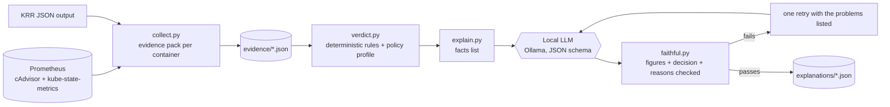

# rightsize-explainer

Tells you **why** a Kubernetes CPU/memory rightsizing recommendation is safe or unsafe, in plain
language, using a local LLM that is not allowed to invent numbers.

Rightsizing tools such as KRR and VPA give you a figure. They rarely tell you whether to trust it.
This project collects the evidence from Prometheus, applies explicit safety rules, and only then asks
a local model to put the result into words. Every figure in the model's text is checked against the
evidence before it is accepted.

> Built as a learning and portfolio project on a small kind cluster. The thresholds are illustrative,
> and nothing here has been validated on a production fleet. See [Limits](#limits).

## How it works



**Code decides, the model explains.**

| Stage | What it does | LLM involved? |
|---|---|---|
| Collect | CPU p50/p95/max, 1-minute peak, peak memory, throttling, restarts, OOM kills, history length, configured requests/limits. Missing data is `null`, never `0`. | No |
| Verdict | `decrease_ok`, `decrease_blocked`, `increase_supported`, `increase_optional`, `no_change`, `no_request_set`, `insufficient_evidence`, each with reasons that cite the evidence fields they used. | No |
| Explain | Writes a headline and one explanation per resource from a fixed list of pre-formatted facts. | Yes |
| Check | Rejects the output if the decision differs from the verdict, a figure is not in the facts, or a blocking or supporting reason is left out. | No |

## What the lab shows

`scenarios/explainer-lab.yaml` creates five workloads with known behaviour. Real verdicts from a
6-hour window on a kind cluster (lab profile, KRR output included):

| Workload | CPU | Memory | Why |
|---|---|---|---|
| steady-overprovisioned | decrease_ok | decrease_ok | Idle nginx at 500m / 512Mi |
| throttled-cpu | **decrease_blocked** | decrease_ok | Throttled in 60% of CPU periods, so measured usage understates demand |
| leaky-memory | decrease_ok | **increase_supported** | OOM kills, 17 restarts, peak working set 124Mi against a 128Mi limit |
| bursty-rare | increase_supported | decrease_ok | KRR says 0.409 cores, a 5-minute-rate p95 says 0.108 (flagged `K_DISAGREES`) |
| batch-periodic | increase_supported | decrease_ok | CronJob pods live about 4 minutes; KRR returned "Not enough data" |

### Example output (qwen2.5-coder:14b, batch-periodic)

```
batch-periodic: increase CPU is supported, memory can be decreased
CPU:    The current CPU request of 0.200 cores is below the p95 usage of 0.613 cores.
        The candidate request of 0.613 cores (a +206% increase) is supported by this observation.
Memory: The current memory request of 64Mi is above the peak working set of 5Mi.
        The candidate request of 5Mi (a -50% decrease) is below the minimum floor of 32Mi,
        so it will be adjusted to 32Mi.
caveat: Workload runs intermittently: 0.8 h of samples across a 4.6 h span; ...
```

### Model benchmark

12 synthetic cases (covering every verdict type) plus the 5 real lab workloads, one local model:

| Model | Cases | Passed first try | Passed after retry | Avg seconds |
|---|---|---|---|---|
| qwen2.5-coder:14b | 17 | 17/17 | 17/17 | 5.9 |

"Passed" means: the decision matches the verdict, every figure appears in the facts with the same
value and unit, and every blocking, warning or supporting reason is covered.
The first version of the reason-coverage check was too strict (it rejected a correct sentence that
said "request is below usage" because it wanted the word "above"). That was fixed by also accepting
text that quotes the reason's figures. Early benchmark runs showed 15/17 for that reason.

## Findings worth knowing

- **KRR applies its own floors** (`--cpu-min 10`, `--mem-min 100`), so on small workloads its memory
  figure is just the floor. The adapter detects this and falls back to a usage-based figure.
- **A 5-minute rate hides short bursts.** KRR's finer sampling gave 0.409 cores for `bursty-rare`
  where the 5-minute p95 gave 0.108 against a measured 1-minute peak of 0.663.
- **Short-lived pods break per-pod history.** History is measured per workload (first to last sample
  across all pods) so CronJobs are not reported as having 4 minutes of data.
- **Restarted containers create duplicate series.** Left unmerged, `leaky-memory` showed 36Mi when its
  real peak was about 124Mi. Series are merged and restart counts rounded.

## Run

Needs Python 3.11+ and no extra packages. A kind cluster with Prometheus (for example the
[resource-review mixin's](https://github.com/ved/resource-review-mixin-k8) `make dev`) and
[Ollama](https://ollama.com) with a model installed.

```bash
make test                                      # 81 tests, fake Prometheus and fake Ollama
make lab                                       # apply the five lab workloads
make collect WINDOW=6h KRR=~/krr-lab.json      # evidence packs (KRR optional)
make verdict PROFILE=lab                       # deterministic verdicts
make explain [ONLY=bursty] [MODEL=...]         # LLM explanations, checked
make benchmark MODELS=qwen2.5-coder:14b        # score models
```

To generate the KRR file (KRR needs Python 3.10 to 3.12):

```bash
python krr.py simple -p http://127.0.0.1:9090 -n explainer-lab --history_duration 4 \
  -f json --fileoutput ~/krr-lab.json
```

Defaults: Prometheus `http://127.0.0.1:9090`, Ollama `http://127.0.0.1:11434`.
Override with `PROM=`, `NS=`, `WINDOW=`, `PROFILE=`, `MODEL=`.

## Layout

```
src/explainer/
  prom.py        Prometheus HTTP client
  collect.py     evidence packs
  krr.py         reads `krr simple -f json`
  verdict.py     rules, policy profiles (lab / dev / production)
  explain.py     facts, prompt, Ollama call, checks, retry
  faithful.py    figure extraction and comparison
  synthetic.py   12 hand-built benchmark cases
  benchmark.py   model scoring
scenarios/       lab workloads
tests/           81 tests
```

## Limits

- **Lab scale.** Five workloads, hours of history. Production needs days or weeks (the `dev` and
  `production` profiles ask for 7 and 28 days).
- **Thresholds are illustrative**, taken from examples in the LearnKube rightsizing book, not
  standards. Tune them to your own risk tolerance.
- **The checker verifies figures, decisions and reason coverage, not truth.** A sentence can quote
  correct figures and still be misleading. Topic coverage uses keywords and figure matching.
- **Workload names come from pod names**, not owner references. Revisions are not tracked.
- **No latency, error-rate or SLO data.** A decrease that looks safe on resource metrics can still hurt.
- **One model benchmarked** on 17 cases. The synthetic cases are fiction, built to cover verdict types.
- **VPA is not integrated yet.** HPA-managed workloads are not handled specially.
- **No automatic changes.** The tool recommends and explains; it never edits a manifest.

## Roadmap

- VPA recommender output alongside KRR (needs metrics-server in the cluster)
- Owner-reference-based workload names and per-revision history
- A JVM scenario (heap versus container memory)
- Waivers with expiry, and per-namespace policy layering
